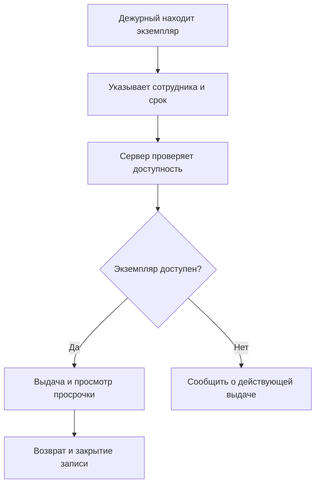

# 219 · Журнал выдачи ключей

Репозиторий `key-checkout-log` · приложение с сервером

**Продукт и интерфейс.** Администратор регистрирует физические ключи, выдаёт ключ сотруднику и фиксирует возврат. Дежурный видит доступные ключи, ожидаемые возвраты и просрочки. Историю можно отфильтровать по ключу, дате или типу операции.

**Архитектура и данные.** React, FastAPI и SQLite. Записи ключей содержат условную метку и номер экземпляра, журнал хранит сотрудника и время выдачи и возврата. Сервер разрешает одну активную выдачу на экземпляр, операции доступны дежурному. Демонстрация использует вымышленные обозначения помещений. ML не нужен.

**Блок-схема основного сценария**

**Функциональные правила.** Выдача создаёт запись с сотрудником и плановым сроком. Просрочка определяется на чтении по текущему времени, возврат фиксирует фактическую дату. Повторный вызов возврата оставляет исходное время закрытия.

**Контракты реализации.** API `GET /keys`, `POST /key-loans`, `POST /key-loans/{id}/return` и `GET /key-loans?status=overdue`. Уникальный индекс активной выдачи и серверная проверка роли защищают изменение состояния.

**Проверки граничных случаев.** Проверить два экземпляра одного ключа, точную границу срока и повторное нажатие «Вернуть». В истории возврат учитывается один раз.

**Разработка и приёмка.** Реализовать каталог, выдачу и возврат, добавить поиск и экспорт журнала. Выдать ключ с истекшим тестовым сроком, увидеть его в просроченных, заблокировать повторную выдачу и вернуть ключ. После возврата активная выдача пропадает, история остаётся.
